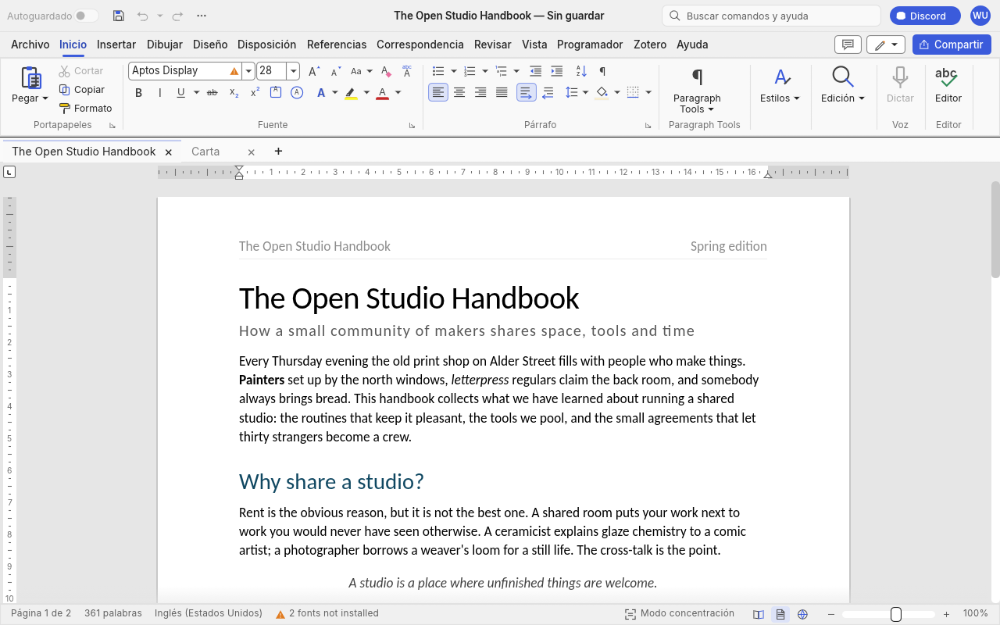

# DexWordCraft

La interfaz de escritorio de [WordCraft](https://github.com/storytold/wordcraft), el procesador de
textos de código abierto escrito en Rust, en Android. Está pensada para **Samsung DeX** y para el
modo de ventanas de escritorio de Android (monitor, ratón y teclado), y funciona también en tabletas
y móviles.

No se reescribe la interfaz: se compila para Android la propia interfaz egui de WordCraft
(`wordcraft-ui-egui`) y se le pone debajo la capa Android compartida de los Crafting Apps
([craft-android](https://github.com/manoloGith/craft-android)), la misma que usan
[DexPdfCraft](https://github.com/manoloGith/DexPdfCraft) y
[DexGridCraft](https://github.com/manoloGith/DexGridCraft).

> Estado: **0.1.0, todavía sin probar en un dispositivo.** Las fases 0 a 7 están hechas y el APK
> compila. Lo que hay que comprobar al instalarlo está en [docs/pruebas.md](docs/pruebas.md). El
> plan y las decisiones están en [docs/plan.md](docs/plan.md), y los cambios a WordCraft, en
> [docs/fork.md](docs/fork.md).



## Cómo está hecho

```
DexWordCraft/
├── upstream/                 submódulo: fork manoloGith/wordcraft, rama dexcraft/android
├── craft-android/            submódulo: manoloGith/craft-android (capa Android + winit con W-DEX1..3)
├── apps/dexwordcraft/        la crate de la app (cdylib que carga Android) + binario de escritorio
│   ├── src/lib.rs            DexWord: arranca la interfaz de WordCraft como su binario de escritorio
│   ├── src/android/mod.rs    android_main y los Services de WordCraft sobre craft-android
│   ├── src/prefs.rs          ui.json, diccionario, fuentes y recuperación, donde los guarda WordCraft en Linux
│   └── android/              proyecto Gradle: MainActivity : CraftActivity
├── scripts/                  fetch-build-inputs.sh (craft-i18n), sync-upstream.sh (rebasa el fork)
├── fastlane/metadata/        F-Droid / Obtainium
└── .github/workflows/        android.yml (CI), release.yml (firma + release)
```

## Compilar

Requisitos:

- `rustup`, que instala la versión y los targets de `rust-toolchain.toml`.
- cargo-ndk: `cargo install cargo-ndk --version 4.1.2 --locked`.
- Android SDK (plataforma 36, build-tools 36.0.0) y NDK 29.0.14206865.
- JDK 17 o posterior.

```bash
git clone --recursive https://github.com/manoloGith/DexWordCraft
```

Las traducciones y los diccionarios de ortografía vienen de
[craft-i18n](https://github.com/storytold/craft-i18n), en la revisión que fija WordCraft. Sin ese
paso, la interfaz sale solo en inglés:

```bash
cd DexWordCraft && scripts/fetch-build-inputs.sh
```

```bash
cd apps/dexwordcraft/android && ./gradlew assembleDebug -Pdexwordcraft.abis=arm64-v8a
```

El APK queda en `app/build/outputs/apk/debug/`. La biblioteca de Rust se compila optimizada también
en debug, porque sin optimizar la maquetación y el dibujo son demasiado lentos;
`-Pdexwordcraft.rustDebug=true` la deja sin optimizar.

Para iterar sin dispositivo, la misma ventana en escritorio, sin los selectores ni el portapapeles
del sistema (WordCraft usa entonces su propio explorador de archivos):

```bash
cargo run -p dexwordcraft --features desktop -- --sample
```

Publicar una versión: [docs/releasing.md](docs/releasing.md). F-Droid y Obtainium:
[docs/fdroid.md](docs/fdroid.md).

## Licencia

MIT o Apache-2.0, como WordCraft. Los avisos y las marcas están en [NOTICE.md](NOTICE.md).
